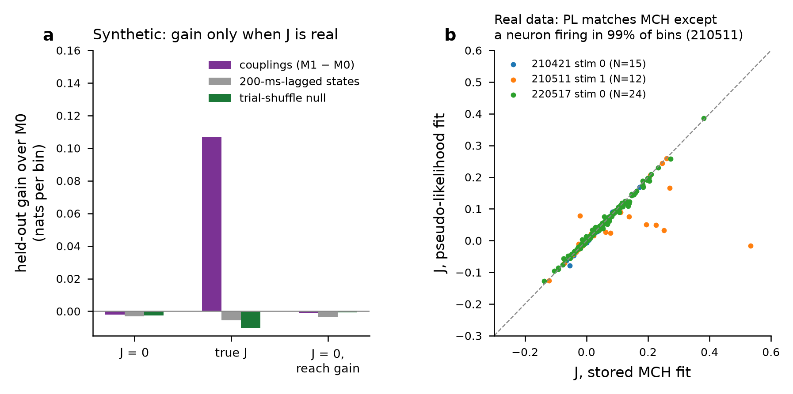
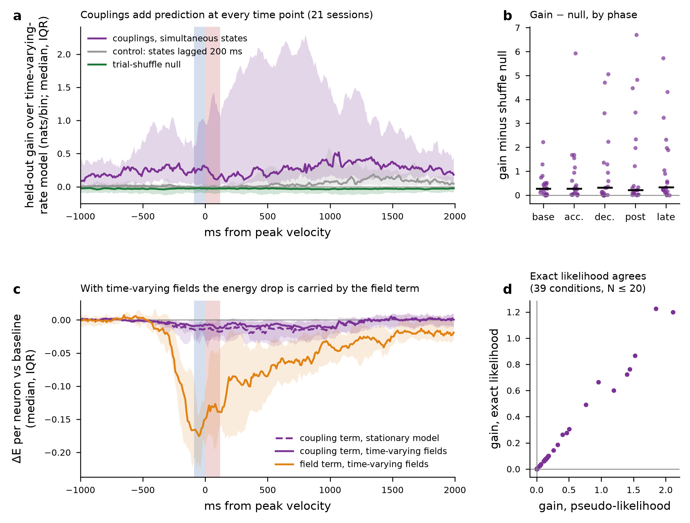
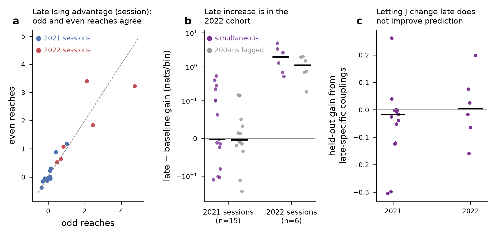
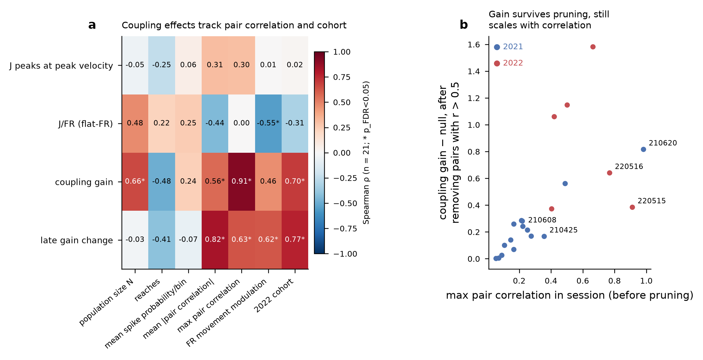

# Is there pairwise coupling beyond shared rate modulation? Time-varying-field Ising model (2026-09-29)

**Question (item E1 in RESULTS_LOG_FOR_PAPER.md).** The earlier checks showed that a stationary Ising model's advantage during the reach disappears once the independent model's rates vary with the reach. That left open whether neurons couple beyond their shared, reach-locked rate changes. This analysis gives the pairwise model the same time-varying fields and asks whether the couplings still add anything on held-out reaches.

**Data.** 63 conditions (21 sessions × 3 stimuli), 1,249 reaches, 10-ms bins. Binarized spikes were exported from `per_reach_state.csv` (they match the stored firing rate to 6e-16), with the same 5-fold split over reaches used for the earlier cross-validated likelihoods. Statistics are session-level Wilcoxon tests with BH-FDR.

## Models
Every model was fitted by L2-penalized pseudo-likelihood: one logistic regression per neuron, with J symmetrized and the fields refitted with J fixed (`tvfield_model.py`).
- **M0, time-varying independent:** h_i(t) on a cubic B-spline basis with knots every 50 ms from −600 to +1,600 ms around peak velocity and every 250 ms elsewhere (67 basis functions), and J = 0.
- **M1, time-varying fields plus static couplings:** the same h_i(t), plus J_ij.
- **Controls:**
  - *Trial-shuffle null:* reach identity is permuted independently for each neuron, which keeps each neuron's reach-locked rate exactly but removes trial-to-trial co-variation. 20 shuffles per condition, with the same cross-validation.
  - *Lagged-state model:* other neurons' states are taken 200 ms earlier, to detect slow co-fluctuation.
  - *Epoch-specific J:* separate coupling offsets for the reach (±0.5 s) and late (+0.5 to +1.5 s) epochs.
- **Scores:** held-out conditional (pseudo-) log-likelihood for all conditions, and exact log-likelihood (enumerated log Z(t)) for the 39 conditions with N ≤ 20.

## Validation
On synthetic populations with known h(t) and J:
- the couplings improve held-out fit only when J is present (+0.107 nats/bin; J recovered with r = 0.98);
- with J = 0, including a per-reach gain fluctuation, the gain is ≤ 0;
- the shuffle null and the lagged control stay ≤ 0 in every case.

On real data the pseudo-likelihood J matches the stored MCH J in two of three reference conditions (r = 0.995 and 0.997). The exception is 210511 stim 1 (r = 0.65), which has a neuron firing in 99% of bins; there the pseudo-likelihood fit reproduces the data moments better (rms error in the pairwise correlations 0.0006 vs 0.0011).

## Results

1. **Couplings carry information beyond shared rates.** With time-varying fields, J improves held-out prediction in **21/21 sessions** and in **63/63 conditions** above the shuffle null's 95th percentile. The median is +0.26 nats/bin above null, and the null itself is −0.03.
   - **Exact likelihood:** 38/39 conditions with N ≤ 20 are positive, and the exact gain tracks the pseudo-likelihood gain (ρ = 0.999).
   - **Pair pruning:** the gain survives dropping one unit of every pair with r > 0.5 (16 conditions in 7 sessions): still 63/63 conditions above null.
2. **The coupling contribution is present at rest and does not increase during the reach.** Gain above null is positive at baseline (20/21), in acceleration (20/21), deceleration (18/21) and post-movement (21/21). The change from baseline is ≈ 0 in acceleration, deceleration and post-movement (p = 0.45 to 0.50).
3. **Couplings do not measurably change during the reach.** Fitting separate couplings for the reach and late epochs does not improve held-out prediction (9/21 sessions, p = 0.71). The fitted offsets are slightly positive (reach +0.009 and late +0.008, against a baseline mean J of 0.022; 17/21, p_FDR ≤ 0.005), but they do not generalize to held-out reaches, so a change in coupling strength is not established.
4. **The energy decomposition depends on the model.** In the time-varying-field model the movement-related energy drop is carried by the **field term**: about −0.17 per neuron at peak, compared with −0.01 for the coupling term (acceleration 20/21, p_FDR = 2e-5). The coupling term still falls (18/21, p_FDR = 0.004), at about 70% of its size in the stationary model.
   - In the stationary model the drop appeared in the coupling term only because stationary fields cannot follow the rate changes.
   - "The energy drop is carried by J" (B2) is therefore a property of the stationary model, not of the population.
5. **The late post-reach increase (+0.5 to +1.5 s) is specific to the 2022 cohort.**
   - Across all sessions, the coupling gain rises late relative to baseline (13/21, p_FDR = 0.023).
   - The effect is confined to the 2022 recordings: 6/6 sessions, median +1.97 nats/bin, against 7/15 in 2021 (p = 0.45). It survives pair pruning (6/6).
   - It is reproducible within session, since odd and even reaches agree (ρ = 0.89), but it is not consistent across stimuli.
   - The 200-ms lagged control rises in the same window (2022: 6/6), so part of the late effect reflects slow shared fluctuation rather than same-bin coupling.
   - Letting J change in the late epoch does not improve prediction.
   - This epoch was discovered in these data, so none of these checks is confirmatory.

## Sessions with the strongest effects

- **Coupling gain:** tracks the session's maximum pair correlation (ρ = 0.91), mean |pair correlation| (0.56), N (0.66) and the 2022 cohort (0.70), all p_FDR < 0.05.
- **Late change:** tracks mean |correlation| (0.82) and cohort (0.77).
- **220516:** an unusually synchronized 2022 population, with 24 to 53 pairs at r > 0.5 out of 19 units. Pruning removes 7 to 12 of its units.
- **Peak-velocity J clustering (210425, 210608, 210512):** these are ordinary 2021 sessions. The effect has no significant correlate among N, reaches, rate, correlation, FR modulation or cohort.
- **Flat-FR dissociation:** larger where firing-rate modulation is weaker (ρ = −0.55), which follows from how the ratio is defined.
- **Cohort caveat:** the 2022 cohort differs in correlation structure, and "cohort" here is inferred from the session date prefix, not from animal records. Whether the 2022 sessions reflect different animals, recording sites or sorting settings should be checked against the lab's records.

## Verdict
**Resolved.** Purkinje-cell populations have pairwise coupling beyond their shared, reach-locked rate modulation: couplings improve held-out prediction in every session and condition once fields track the reach. This coupling is **present at rest and does not measurably change during the reach**. What changes during movement is the fields (rates). The earlier movement-time signals, the J-term energy drop and the Ising advantage over a constant-rate model, came from the stationary model absorbing rate changes into the coupling term.

## Files
`tvfield_model.py`, `run_tvfield.py`, `run_epochJ.py`, `run_pruned.py`, `export_spikes.py`; `tvfield_cv_scores.csv`, `tvfield_phase_summary.csv`, `trial_shuffle_null.csv`, `energy_decomposition_tvfield*.csv`, `epochJ_results.csv`, `epochJ_summary.csv`, `late_epoch_consistency.csv`, `session_effect_profile.csv`, `session_effect_correlations.csv`, `pruned_gain_*.csv`, `tvfield_validation*.csv`.
